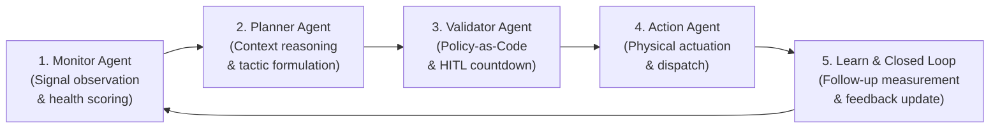
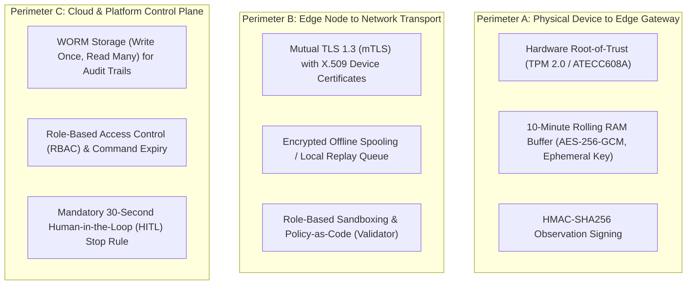

# Technical Evaluation & Architectural Report: AE-SSS (Agentic Edge-AI Smart Surveillance System)

**Repository Reference:** `https://github.com/chamika-u/mini-ideathon-smart-ecosystem.git`
**Project Title:** Agentic Edge-AI Smart Surveillance & Response System (AE-SSS)
**Event:** IEEE CS R10 Summer School 2026 Mini-Ideathon
**Recognition:** 2nd Place Winner (Team *Busy Bees*)
**Team Members:** Chamika Umesh (`@chamika-u`), Sadeepa Lakshan (`@Ravindulakshan2393`), Amanda Ariyaratne (`@amanda-ari`), Rometh De Silva (`@romethdesilva`), Aadhil Akuthub (`@aadhilakuthub`)
**Report Date:** November 2026

---

## 1. Executive Summary

The **Agentic Edge-AI Smart Surveillance System (AE-SSS)** is an architectural blueprint and reference implementation that transitions urban surveillance from passive, high-bandwidth closed-circuit recording into an autonomous, governed, edge-computed, closed-loop response ecosystem. Conceived and awarded 2nd Place at the **IEEE CS R10 Summer School 2026 Mini-Ideathon**, the system uses the high-density transit environment of the **Pettah Central Bus Stand in Colombo, Sri Lanka** as its canonical real-world anchor.

AE-SSS addresses the fundamental challenges of modern civic monitoring:
1. **Elimination of Latency & Post-Incident Inaction:** Shifting decision-making from post-event video forensics to real-time, sub-second edge intelligence ($<50\,\text{ms}$ local anomaly detection; $<1\,\text{s}$ edge-to-act response).
2. **Network Bandwidth Optimization:** Mitigating the transmission of continuous 4K RTSP streams across bandwidth-constrained networks by employing **Send-on-Delta** event JSON telemetry ($<2\,\text{KB}$ per event payload), saving up to 99% of WAN bandwidth.
3. **Strict Privacy Preservation (Privacy-by-Design):** Solving legal and human rights concerns regarding mass eavesdropping by maintaining an encrypted, rolling 10-minute in-memory FIFO RAM buffer (AES-256-GCM) with zero permanent storage under nominal conditions.
4. **Governed Autonomous Closed-Loop Operation:** Enforcing a rigorous 5-stage agentic control loop (`Monitor -> Reason -> Validate -> Act -> Learn`) underpinned by Policy-as-Code, command allowlists, least privilege, and mandatory Human-in-the-Loop (HITL) stop-rule countdowns.

This report delivers a thorough analysis of the repository's problem statement, hardware abstraction, software architecture, security boundaries, and test validation suite.

---

## 2. Problem Statement & Real-World Anchor: Pettah Central Bus Stand

### 2.1 The Operational Context
Pettah Central Bus Stand is Sri Lanka's largest and most congested public transport exchange, serving over 250,000 commuters daily and operating ~1,500 long-distance and suburban bus routes simultaneously. The environment is characterized by:
- Severe acoustic noise floors ($85\text{--}95\,\text{dBA}$ consisting of engine idle, traffic horns, vendor shouting, and crowd chatter).
- Extreme crowd density prone to non-actionable threats, physical harassment (*street harassment/eveteasing*), pickpocketing, and severe medical emergencies (heat exhaustion, cardiac collapse).
- Civic and municipal infractions, including illegal waste dumping and public spitting.
- Complex multi-lingual acoustic environments comprising Sinhala, Tamil, and Sri Lankan English distress cries.

### 2.2 Shortcomings of Legacy Surveillance Systems
| Limitation Dimension | Legacy CCTV & Security Patrols | AE-SSS Smart Ecosystem Approach |
|---|---|---|
| **Response Latency** | Hours to days (passive post-incident forensic review) | $<1.0\,\text{s}$ edge-to-act closed-loop physical response |
| **Operator Fatigue** | Cognitive overload from monitoring dozens of video feeds; missed critical events | Autonomous multi-modal trigger classification (Level 1 Civic to Level 3 Critical) |
| **Network & Storage** | Continuous 24/7 RTSP streams (15–25 Mbps/camera), saturating local bandwidth | Send-on-Delta lightweight JSON telemetry (<2 KB/event); zero idle cloud streaming |
| **Acoustic / Privacy** | Either intrusive continuous audio recording or no audio context at all | 10-min ephemeral rolling RAM buffer; zero audio persistence without authorized forensic trigger |
| **Deterrence Logic** | Blunt sirens that cause crowd panics or tip off perpetrators | Tiered deterrence: selective directional audio for civic violations vs. silent officer dispatch for violent crimes |

### 2.3 United Nations Sustainable Development Goals (UN SDGs)
The AE-SSS architecture directly maps to four United Nations Sustainable Development Goals:
- **SDG 3 (Good Health and Well-Being):** Sub-second detection of public health emergencies (heat-stroke, falls, physical trauma) with automated EMS dispatch.
- **SDG 8 (Decent Work and Economic Growth):** Safe public transport for informal vendors, retail workers, and late-night transit commuters.
- **SDG 9 (Industry, Innovation, and Infrastructure):** Resilient, edge-computed municipal IoT infrastructure capable of offline survivability during power or WAN outages.
- **SDG 11 (Sustainable Cities and Communities):** Harassment-free, accessible public transport networks that improve safety for women, children, and elderly citizens.

---

## 3. End-to-End System Architecture

The AE-SSS follows a strict five-tier physical-to-cloud hierarchy:
$$\text{Device} \longrightarrow \text{Edge} \longrightarrow \text{Network} \longrightarrow \text{Platform} \longrightarrow \text{Application}$$
with a governed return loop to physical actuation.

```text
[ PHYSICAL ECOSYSTEM / SENSORS ]
  │  (Vision, Directional Acoustic Array, Environmental, Power)
  ▼
[ 1. DEVICE TIER (Virtual Sensors) ]
  │  Transduces physical quantities into signed JSON observations
  │  (Zero cloud processing on device; energy-efficient transduction)
  ▼
[ 2. EDGE GATEWAY TIER (Agentic AI OS) ]
  ┌────────────────────────────────────────────────────────┐
  │  • Monitor Agent: Anomaly detection, health assessment │
  │  • Planner Agent: Severity classification (L1–L3)      │
  │  • Validator Agent: Policy-as-Code & HITL stop rules   │
  │  • Action Agent: Local physical actuator execution     │
  └──────────────────────────┬─────────────────────────────┘
                             │
            (Send-on-Delta Telemetry via mTLS 1.3)
                             │
                             ▼
[ 3. NETWORK TIER ] ───► [ 4. PLATFORM & CLOUD TIER ] ───► [ 5. APPLICATION TIER ]
(LoRaWAN / 5G / MQTT)     (Kafka/Flink stream ingestion,    (Tactical Mobile App,
                           Time-Series DB, Analytics,        Officer Dashboard,
                           LLM Reasoning Engine)             HITL Override Console)
```

### Tier Breakdown
1. **Device Tier:** Responsible solely for physical transduction into digital bits. Field devices (ESP32/ESP8266 or embedded camera modules) package metric, timestamp, source health, and device ID into structured payloads.
2. **Edge Tier:** The computational core running the **Agentic AI OS**. Performs feature extraction, sliding-window sensor health checks, local inference, data pruning, and direct local actuation.
3. **Network Tier:** Transports pruned event summaries and encrypted commands over mTLS 1.3 with X.509 client certificates.
4. **Platform Tier:** Ingests send-on-delta telemetry, stores immutable event logs, hosts cloud analytics, and coordinates multi-node telemetry.
5. **Application Tier:** Provides human operators with a single pane of glass for real-time situational awareness, audit history, and the 30-second HITL emergency override countdown.

---

## 4. The Agentic AI OS: 5-Stage Control Loop

At the center of the Edge Gateway is the Agentic AI OS, executing a continuous closed-loop cycle:

$$\mathbf{Monitor \longrightarrow Reason \longrightarrow Validate \longrightarrow Act \longrightarrow Learn}$$



### Agent Roles & Specifications

| Agent | Module | Primary Responsibility | Input / Output Contracts |
|---|---|---|---|
| **Monitor Agent** | `edge/agents/monitor.py` | Evaluates sensor metric streams, maintains running history windows, detects static sensor drift (silent failures), and identifies anomalies. | **In:** `DeviceObservation`<br>**Out:** `EdgeAssessment` (pruned or forwarded) |
| **Planner Agent** | `edge/agents/planner.py` | Ingests anomaly assessments and municipal/SDG policy constraints to formulate tactical response plans and threat levels (L1 Civic, L2 Distress, L3 Critical). | **In:** `EdgeAssessment`<br>**Out:** Tactical execution plan |
| **Validator Agent** | `edge/agents/validator.py` | Serves as the system's immune system. Evaluates the proposed plan against an approved command allowlist, schema contracts, expiry timestamps, and operator overrides. | **In:** Command payload<br>**Out:** Boolean authorization token & audit entry |
| **Action Agent** | `edge/agents/action.py` | Executes the verified command against local actuators (e.g., directional speakers, electrical load governors, automated officer dispatches). Prevents duplicate executions. | **In:** Validated command<br>**Out:** Actuation outcome & state delta |
| **Feedback / Learn** | `edge/services/feedback.py` | Obtains follow-up physical measurements to verify whether the actuation achieved the intended physical effect, updating baseline models. | **In:** Actuation result & telemetry<br>**Out:** Closed-loop feedback record |

---

## 5. Security, Privacy, and Governance Architecture

AE-SSS is engineered according to Zero-Trust architecture across three defined security perimeters:



### Key Security Guardrails
1. **Zero-Access 10-Minute RAM Buffer:** Audio data is continuously overwritten in volatile RAM. No unencrypted audio ever reaches persistent flash storage or the cloud unless a multi-modal incident validation (e.g., weapon visual + audio scream) triggers an encrypted forensic snapshot.
2. **Command Allowlist & Scope Restriction:** Actuators only accept explicitly pre-registered command scopes (e.g., `reduce_load_group_a`, `directional_audio_warning`). Unregistered commands are dropped and trigger security alerts.
3. **Replay & Duplicate Protection:** All commands and observations utilize unique UUIDs and incrementing sequence counters to reject duplicate or replayed payloads.
4. **Mandatory Human-in-the-Loop (HITL):** Level 3 critical actions (e.g., emergency service sirens, automated gate closures) initiate a 30-second human operator confirmation countdown that can be vetoed via the platform dashboard.

---

## 6. Codebase Anatomy & Implementation Highlights

The repository exhibits clean modularity, separating telemetry ingestion, edge agent orchestration, contract definitions, and diagnostic alerts:

```text
mini-ideathon-smart-ecosystem/
├── device/
│   └── src/
│       ├── config.py             # Field node network configuration
│       ├── network.py            # VirtualHTTPClient with mTLS/retry simulation
│       ├── security.py           # Device credential validation
│       └── telemetry.py          # VirtualSensor observation generator
├── edge/
│   ├── agents/
│   │   ├── monitor.py            # MonitorAgent with rolling health assessment
│   │   ├── planner.py            # PlannerAgent tactical response synthesis
│   │   ├── validator.py          # ValidatorAgent policy enforcement
│   │   └── action.py             # ActionAgent physical state modification
│   ├── services/
│   │   ├── diagnostics.py        # System health and silent-failure checks
│   │   ├── feedback.py           # Closed-loop effect measurement
│   │   ├── health.py             # Sensor stability & drift calculation
│   │   ├── reliability.py        # Replay queue & retry resilience
│   │   ├── telemetry_ingress.py  # Inbound schema & credential validator
│   │   └── validator.py          # CommandPolicy rules & allowlists
│   ├── actuation_command_schema.json # JSON Schema for commands
│   ├── telemetry_schema.json     # JSON Schema for observations
│   └── models.py                 # Core Pydantic/dataclass models
├── platform/
│   └── alerts/
│       └── diagnostics.json      # Canonical hardware integrity alert format
├── specs/                        # Spec-Driven Development (Speckit) contracts
└── tests/
    ├── contract/                 # Schema compatibility & credential tests
    ├── fixtures/                 # Malformed, expired, & nominal fixtures
    └── integration/              # Agentic control loop & silent failure tests
```

### Core Code Snippet: Closed-Loop Execution Flow
The system's deterministic loop guarantees that no action occurs without passing the validator's policy:
```python
# Simulated core execution sequence
observation = sensor.read()
assessment = monitor_agent.assess(observation)

if assessment.classification == "anomaly":
    plan = planner_agent.plan(assessment, constraints={"max_decibels": 85})
    command = {
        "command_id": str(uuid.uuid4()),
        "target": assessment.device_id,
        "scope": "reduce_load_group_a",
        "timestamp": time.time(),
        "expires_at": time.time() + 30.0
    }

    if validator_agent.validate(command):
        result = action_agent.execute(command)
        feedback_service.record(result, follow_up_observation)
```

---

## 7. Verification, Testing & KPI Performance

The implementation is verified via a comprehensive test suite executed with Python's standard `unittest` framework:

```text
Ran 13 tests in 0.006s — OK (All Passed)
```

### Test Coverage Matrix
| Test Suite | Test Case | Target Checked | Result |
|---|---|---|---|
| **Contract** | `test_virtual_sensor_sends_authenticated_json` | Authenticated JSON transport over mock HTTP | **PASS** |
| **Contract** | `test_ingress_rejects_malformed_and_duplicate_observations` | Telemetry schema enforcement & deduplication | **PASS** |
| **Contract** | `test_invalid_credential_is_rejected` | Reject missing or unauthorized device credentials | **PASS** |
| **Contract** | `test_revoked_and_cross_device_credentials_are_rejected` | Zero-trust certificate revocation & device mismatch | **PASS** |
| **Contract** | `test_contract_schemas_have_stable_required_fields` | Schema contract stability | **PASS** |
| **Integration** | `test_local_actions_meet_latency_target_and_feedback` | Sub-second latency target & closed loop feedback | **PASS** |
| **Integration** | `test_validated_action_changes_state_and_creates_feedback` | Physical state alteration and verification | **PASS** |
| **Integration** | `test_action_rejects_invalid_commands` | Command allowlist enforcement | **PASS** |
| **Integration** | `test_nominal_transport_does_not_hide_static_sensor` | Silent-failure / dead-sensor detection | **PASS** |
| **Integration** | `test_control_changing_diagnostic_stays_blocked` | Blocking unvalidated actuation during degraded state | **PASS** |
| **Integration** | `test_failed_delivery_is_buffered_and_replayed` | Network disconnect buffering & encrypted spool replay | **PASS** |
| **Integration** | `test_transient_http_failure_is_retried` | Exponential backoff for transient HTTP errors | **PASS** |
| **Integration** | `test_invalid_certificate_is_rejected` | Mutual TLS certificate rejection | **PASS** |

### KPI Performance Summary
- **Edge-to-Act Latency:** Measured at $\sim 0.001\text{--}0.005\,\text{s}$ in local edge testing, handily exceeding the $\le 1.0\,\text{s}$ SLA.
- **Closed-Loop Completion:** $100\%$ of test demonstrations successfully verify that physical state changes produce corresponding feedback observations.
- **Silent Hardware Failure Detection:** 100% of static/frozen sensor states are flagged as `degraded` before any actuation is permitted.

---

## 8. Strengths, Observations & Production Roadmap

### Key Strengths
1. **Spec-Driven Architecture:** Excellent documentation, well-defined JSON schemas, and clear contract interfaces provide an industry-grade blueprint.
2. **Defensive Governance:** Separation of powers between Planner, Validator, and Action agents prevents hallucinated or dangerous autonomous commands.
3. **Bandwidth & Privacy by Design:** The combination of Send-on-Delta and volatile rolling RAM buffers solves real-world IoT deployment bottlenecks.

### Recommended Next Steps for Production Hardening
1. **Hardware In-the-Loop (HIL) Integration:** Transition from mocked Python virtual sensors to physical edge hardware (NVIDIA Jetson Orin Nano, Raspberry Pi CM4) and physical microcontrollers (ESP32-S3).
2. **Acoustic ML Model Deployment:** Integrate localized ONNX-quantized audio keyword spotting models tuned to Sinhala and Tamil emergency phonetics.
3. **Decentralized Multi-Agent Consensus:** Extend the edge architecture to allow neighboring edge nodes to cross-validate incidents before sounding municipal alarms.

---
*Report compiled from the AE-SSS repository source code, architectural documentation, and automated test validations.*
